# CryptoWatch — Compte rendu du TP DevSecOps
## Chapitre 6 : Monitoring, Logging et Réponse aux Incidents

**Projet :** CryptoWatch  
**Outil de supervision :** Wazuh 4.14.10  
**Environnement :** Ubuntu 24.04.5 LTS sous WSL2 et Docker Compose  
**Agent supervisé :** `cryptowatch-wsl` — ID `001`

---

## Informations du groupe

**Groupe :** GR 5

**Étudiants :**
- Azzeddine Salmoun
- Wail Chairi Mahjor
- Toufik Kharkhour

---

## 1. Introduction

La supervision de la sécurité est une composante essentielle d'une démarche DevSecOps. Elle permet de centraliser les événements, de détecter les comportements inhabituels, de surveiller l'état des systèmes et d'identifier les vulnérabilités susceptibles d'affecter les applications et leur infrastructure.

Dans le cadre de ce TP, la plateforme Wazuh a été déployée avec Docker Compose afin de superviser un environnement Ubuntu exécuté sous WSL2. Un agent Wazuh a été installé sur cette machine pour transmettre les événements au serveur central.

Les travaux pratiques ont porté sur la collecte des journaux, la détection des échecs d'authentification SSH, la surveillance des commandes privilégiées, l'identification des vulnérabilités et le contrôle de l'intégrité des fichiers.

## 2. Objectifs

Les objectifs de ce travail sont les suivants :

- Déployer une architecture de supervision Wazuh avec Docker Compose.
- Installer et connecter un agent Wazuh sur Ubuntu WSL2.
- Centraliser et consulter les événements système.
- Détecter les tentatives de connexion SSH échouées.
- Surveiller les opérations d'élévation de privilèges avec `sudo`.
- Identifier les vulnérabilités des paquets installés.
- Détecter les ajouts et les modifications de fichiers avec File Integrity Monitoring (FIM).
- Analyser les alertes à partir de Wazuh Dashboard.

## 3. Environnement technique

| Composant | Configuration |
|---|---|
| Système d'exploitation | Ubuntu 24.04.5 LTS |
| Environnement Linux | WSL2 |
| Conteneurisation | Docker Engine et Docker Compose |
| Wazuh Manager | 4.14.10 |
| Wazuh Indexer | 4.14.10 |
| Wazuh Dashboard | 4.14.10 |
| Agent | `cryptowatch-wsl`, ID `001` |
| Groupe de l'agent | `default` |
| Interface Web | `https://localhost:8443` |

## 4. Architecture et déploiement

L'architecture repose sur trois services Wazuh exécutés dans des conteneurs Docker :

- **Wazuh Manager :** reçoit les événements des agents, applique les règles de détection et génère les alertes.
- **Wazuh Indexer :** stocke et indexe les données afin de permettre leur recherche et leur analyse.
- **Wazuh Dashboard :** fournit l'interface Web permettant de visualiser les agents, les alertes et les résultats des analyses.

L'agent Wazuh est installé directement sur Ubuntu WSL2. Il collecte les événements de la machine et les transmet au Manager.

```text
                  Navigateur Web
              https://localhost:8443
                         |
                         v
                +------------------+
                | Wazuh Dashboard  |
                |     :5601        |
                +--------+---------+
                         |
                         v
                +------------------+
                |  Wazuh Indexer   |
                |     :9200        |
                +------------------+
                         ^
                         |
                +--------+---------+
                |  Wazuh Manager   |
                |  :1514 / :1515   |
                |  API :55000      |
                +--------+---------+
                         ^
                         |
                +--------+---------+
                |   Wazuh Agent    |
                |  cryptowatch-wsl |
                |    Ubuntu WSL2   |
                +------------------+
```

Le déploiement des services est effectué depuis le répertoire `wazuh/` à l'aide de Docker Compose :

```bash
docker compose --env-file .env up -d
docker compose --env-file .env ps
```

Les trois services — Manager, Indexer et Dashboard — ont été démarrés avec succès. L'interface Web est accessible localement à l'adresse `https://localhost:8443`.

Les ports des services publiés sur l'hôte sont configurés sur l'interface locale `127.0.0.1`.

## 5. Installation et connexion de l'agent

L'agent Wazuh 4.14.10 a été installé sur Ubuntu 24.04.5 LTS sous WSL2.

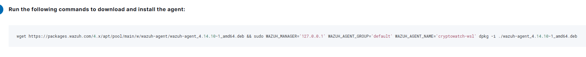 Il a été configuré avec les paramètres suivants :

| Paramètre | Valeur |
|---|---|
| Nom de l'agent | `cryptowatch-wsl` |
| Identifiant | `001` |
| Adresse du Manager | `127.0.0.1` |
| Groupe | `default` |
| Version | `4.14.10` |

L'état du service a été vérifié avec `systemctl`. Le service `wazuh-agent` était en état `active (running)`.

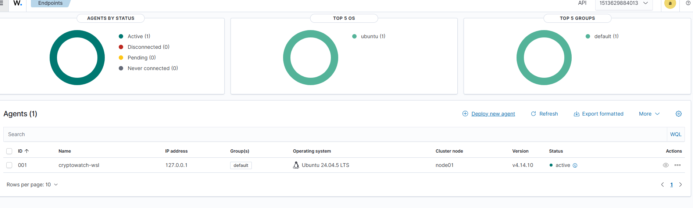

La vérification depuis le Manager avec la commande suivante a confirmé la connexion :

```bash
docker compose --env-file .env exec wazuh.manager /var/ossec/bin/agent_control -lc
```

Le résultat retourné pour l'agent était :

```text
ID: 001, Name: cryptowatch-wsl, IP: any, Active
```

Dans Wazuh Dashboard, l'agent apparaît également avec le statut `active`, l'adresse IP `127.0.0.1`, le système Ubuntu 24.04.5 LTS et la version Wazuh `v4.14.10`.

## 6. Scénario 1 — Détection des échecs d'authentification SSH

### 6.1 Réalisation du test

Le service OpenSSH a été vérifié sur Ubuntu. Un test contrôlé de connexion SSH locale a ensuite été réalisé avec un nom d'utilisateur inexistant afin de générer des événements d'authentification échouée.

Les événements ont été collectés à partir des journaux système et analysés par Wazuh.

### 6.2 Résultats

La règle Wazuh déclenchée est la règle `5710`.

| Champ | Résultat |
|---|---|
| Identifiant de règle | `5710` |
| Description | `sshd: Attempt to login using a non-existent user` |
| Niveau | `5` |
| Agent | `cryptowatch-wsl` |
| Adresse source observée | `127.0.0.1` |
| Nombre affiché dans le Dashboard | `43` |

La vue du Dashboard filtrée sur l'agent `cryptowatch-wsl` et la règle `5710` a affiché 43 événements pendant la période sélectionnée. Ces événements sont classés comme des échecs d'authentification.

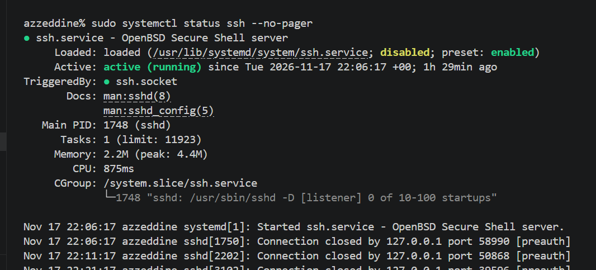

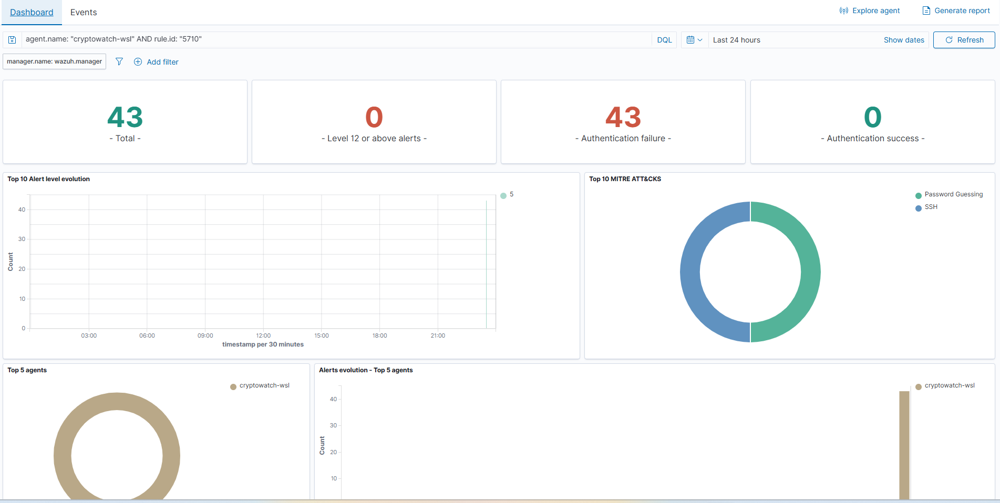

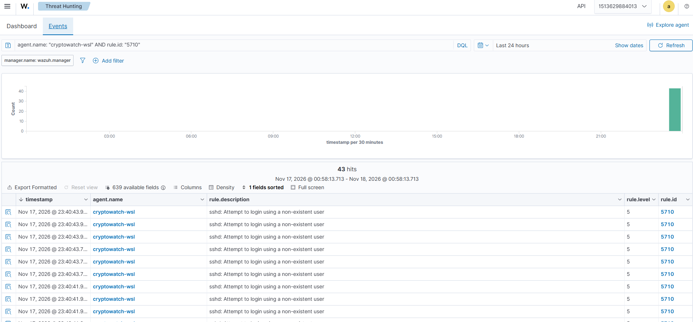

Ce test démontre la capacité de Wazuh à détecter des tentatives de connexion SSH échouées. Il s'agit d'une simulation locale contrôlée et non de la preuve d'une attaque provenant d'un système externe.

## 7. Scénario 2 — Surveillance des commandes sudo

### 7.1 Réalisation du test

Afin de vérifier la surveillance des opérations privilégiées, une commande `sudo` a été exécutée :

```bash
sudo -k
sudo id
```

La commande `id` a retourné l'identité `root`, confirmant que l'opération a été exécutée avec les privilèges administrateur.

### 7.2 Résultats

Wazuh a généré une alerte correspondant à la règle `5402`.

| Champ | Résultat |
|---|---|
| Identifiant de règle | `5402` |
| Description | `Successful sudo to ROOT executed.` |
| Niveau | `3` |
| Utilisateur source | `hp` |
| Utilisateur cible | `root` |
| Commande observée | `/usr/bin/id` |

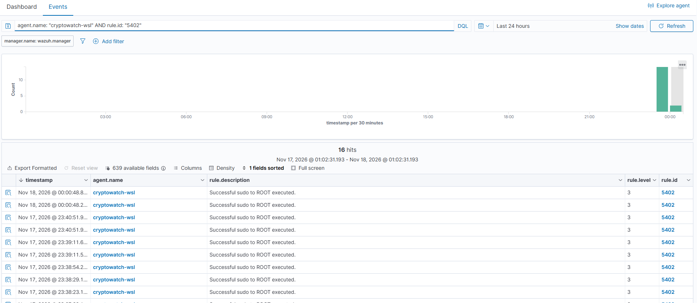

Cette alerte correspond à une opération administrative légitime réalisée dans le cadre du TP. La détection permet de tracer l'utilisation de `sudo`, mais ne signifie pas automatiquement qu'une activité malveillante a eu lieu.

## 8. Scénario 3 — Détection des vulnérabilités

Le module **Vulnerability Detection** de Wazuh a été utilisé pour analyser les paquets installés sur l'agent Ubuntu et identifier ceux dont les versions correspondent à des vulnérabilités connues.

### 8.1 Résultats globaux

Au moment de la consultation, le Dashboard affichait les résultats suivants :

| Niveau de sévérité | Nombre |
|---|---:|
| Critical | 12 |
| High | 129 |
| Medium | 65 |
| Low | 4 |
| **Total** | **210** |

Ces valeurs correspondent aux compteurs présentés dans l'interface Wazuh lors de la capture.

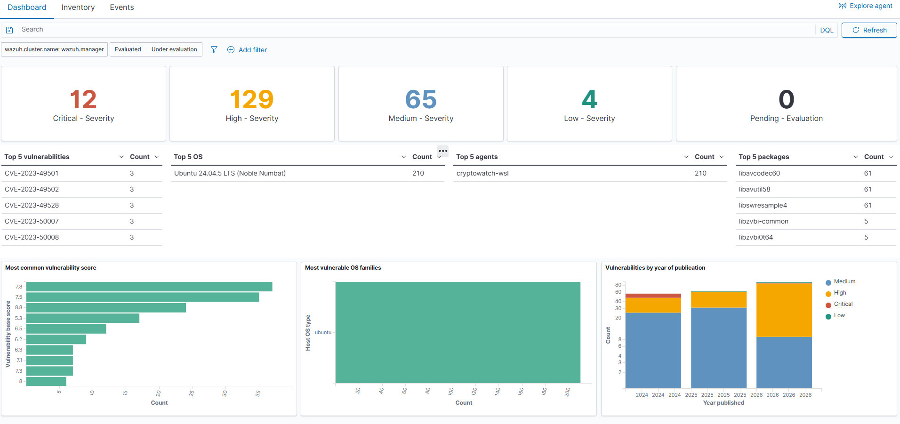

### 8.2 Analyse de CVE-2023-49501

Un exemple identifié dans l'inventaire est la vulnérabilité `CVE-2023-49501`, associée à des composants FFmpeg.

| Champ | Valeur observée |
|---|---|
| Identifiant CVE | `CVE-2023-49501` |
| Paquet détaillé | `libavcodec60` |
| Version installée | `7:6.1.1-3ubuntu5` |
| Sévérité | High |
| Score CVSS | 8.0 |
| Version CVSS | 3.1 |
| Source du scanner | Canonical Security Tracker |

L'inventaire affichait trois paquets associés à ce CVE :

- `libavcodec60`
- `libswresample4`
- `libavutil58`

La condition indiquée par le scanner était :

```text
Package less than 7:6.1.1-3ubuntu5+esm1
```

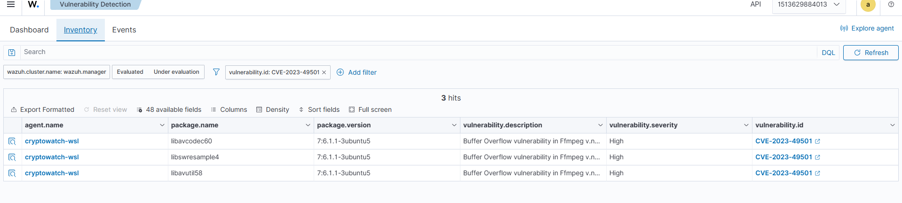

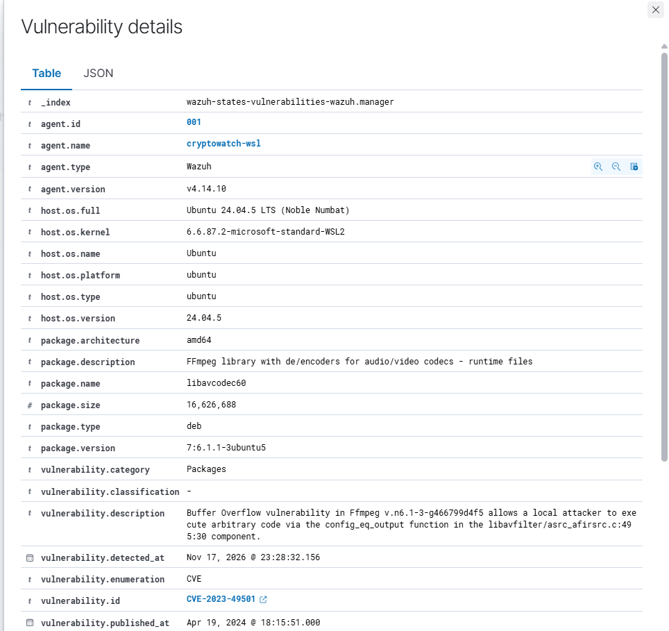

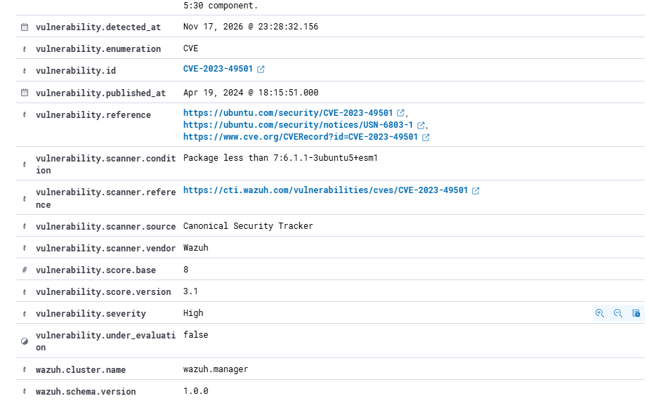

La description de la vulnérabilité mentionne un problème de type buffer overflow dans FFmpeg.

La présence d'une vulnérabilité dans l'inventaire signifie que la version du paquet correspond aux critères du scanner. Elle ne prouve pas que cette vulnérabilité a été exploitée. Aucune opération de mise à niveau ou de correction des paquets n'est déclarée dans ce compte rendu.

## 9. Scénario 4 — File Integrity Monitoring (FIM)

### 9.1 Configuration

Le module File Integrity Monitoring a été configuré pour surveiller en temps réel le répertoire de test suivant :

```text
/tmp/wazuh-fim-test
```

La configuration ajoutée dans le bloc `syscheck` de l'agent est :

```xml
<directories check_all="yes" realtime="yes">/tmp/wazuh-fim-test</directories>
```

Cette configuration permet à Wazuh de surveiller les changements apportés aux fichiers de ce répertoire.

### 9.2 Réalisation du test

Un fichier de test a été créé, puis modifié en ajoutant une deuxième ligne :

```bash
mkdir -p /tmp/wazuh-fim-test
echo "CryptoWatch security monitoring test - initial version" > /tmp/wazuh-fim-test/test-file.txt
echo "CryptoWatch security monitoring test - modified version" >> /tmp/wazuh-fim-test/test-file.txt
```

### 9.3 Résultats

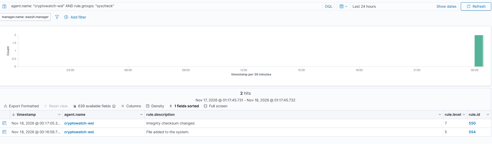

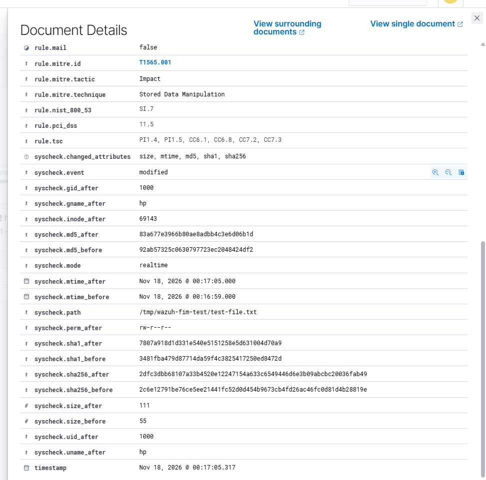

Deux événements ont été détectés :

| Identifiant de règle | Description | Niveau |
|---|---|---:|
| `554` | File added to the system. | 5 |
| `550` | Integrity checksum changed. | 7 |

Les détails de l'événement de modification indiquent :

| Attribut | Valeur |
|---|---|
| Chemin | `/tmp/wazuh-fim-test/test-file.txt` |
| Événement | `modified` |
| Mode de surveillance | `realtime` |
| Taille avant modification | 55 octets |
| Taille après modification | 111 octets |

Les empreintes SHA-256 présentées dans les détails de l'événement sont :

- **Avant :** `2c6e12791be76ce5ee21441fc52d0d454b9673cb4fd26ac46fc0d81d4b28819e`
- **Après :** `2dfc3dbb68107a33b4520e12247154a633c6549446d6e3b09abcbc20036fab49`

L'événement de modification est également associé à la technique MITRE ATT&CK `T1565.001` — Stored Data Manipulation.

Ce scénario démontre la capacité du module FIM à détecter la création et la modification d'un fichier surveillé, ainsi qu'à présenter les changements d'attributs et d'empreintes.

## 10. Analyse des événements et Threat Hunting

La section Threat Hunting de Wazuh Dashboard permet d'explorer les événements collectés et de les filtrer selon différents critères, notamment le nom de l'agent, l'identifiant de règle et la période.

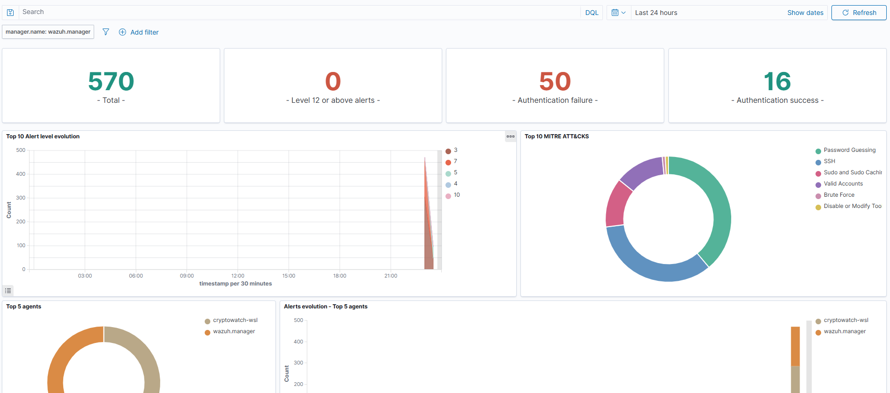

Les recherches réalisées pendant le TP ont notamment utilisé les filtres suivants :

```text
agent.name: "cryptowatch-wsl" AND rule.id: "5710"
agent.name: "cryptowatch-wsl" AND rule.id: "5402"
agent.name: "cryptowatch-wsl" AND rule.groups: "syscheck"
```

Ces filtres permettent d'isoler les événements associés aux scénarios SSH, sudo et FIM afin de faciliter leur analyse.

## 11. Synthèse des résultats

| Fonctionnalité | Élément vérifié | Résultat |
|---|---|---|
| Déploiement Wazuh | Manager, Indexer et Dashboard | Services démarrés |
| Supervision de l'agent | `cryptowatch-wsl`, ID `001` | Active |
| Détection SSH | Règle `5710` | 43 événements affichés dans le Dashboard |
| Surveillance sudo | Règle `5402` | Événements détectés |
| Vulnerability Detection | Inventaire des paquets | 210 vulnérabilités affichées |
| Analyse CVE | `CVE-2023-49501` | Sévérité High, CVSS 8.0 |
| FIM — ajout | Règle `554` | Détecté |
| FIM — modification | Règle `550` | Détecté |

Les compteurs affichés dans le Dashboard dépendent de la période et des filtres sélectionnés. Un comptage ultérieur du fichier courant `alerts.json` a retourné 0 événement pour la règle `5710`, 18 pour la règle `5402`, 1 pour la règle `554` et 1 pour la règle `550`. La différence entre ces comptages et les résultats affichés précédemment dans le Dashboard est rapportée telle qu'observée, sans attribuer de cause non vérifiée.

## 12. Conclusion

Ce TP a permis de déployer une plateforme centralisée de supervision avec Wazuh, de connecter un agent Ubuntu WSL2 et de vérifier plusieurs mécanismes de détection.

Les tests réalisés ont couvert les échecs d'authentification SSH, l'utilisation de commandes privilégiées, l'identification de vulnérabilités sur les paquets installés et la surveillance de l'intégrité des fichiers.

Les résultats montrent l'intérêt d'une solution SIEM/XDR pour centraliser les journaux, détecter des événements de sécurité et faciliter leur investigation. Cette architecture constitue une base de laboratoire pour approfondir la supervision, la gestion des vulnérabilités et la réponse aux incidents dans une démarche DevSecOps.
