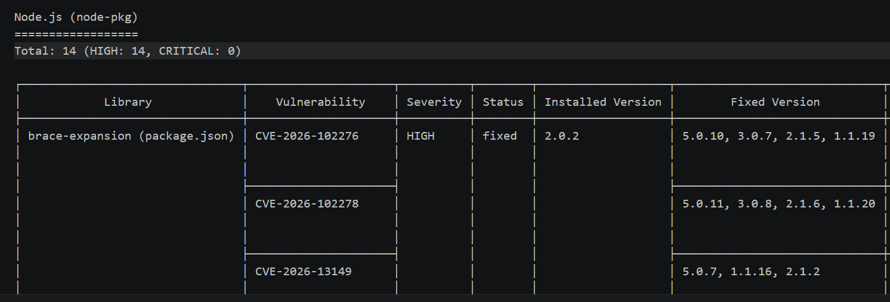
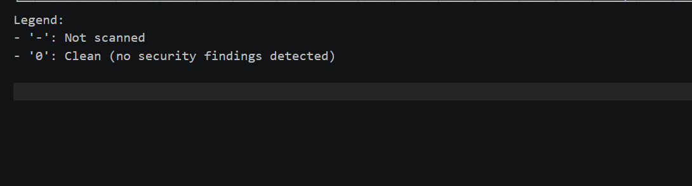
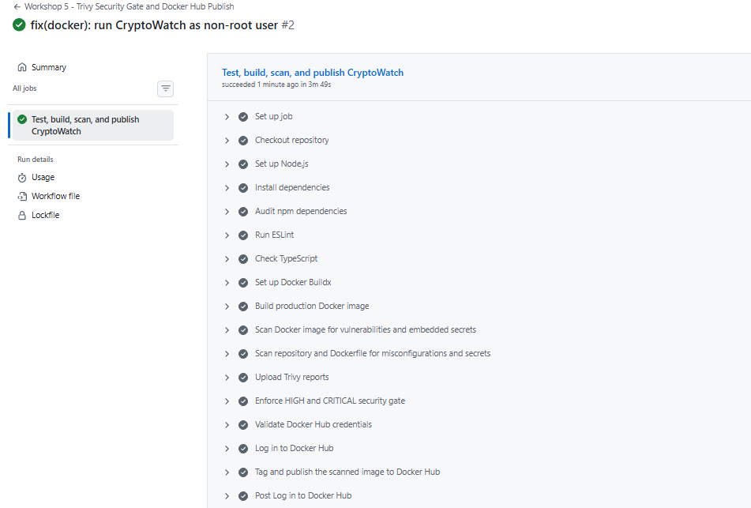

# Workshop 5 — Sécurité des conteneurs avec Trivy

## Informations du groupe

**Groupe :** GR 5  
**Étudiants :**
- Azzeddine Salmoun
- Wail Chairi Mahjor
- Toufik Kharkhour

**Projet :** CryptoWatch  
**Dépôt Docker Hub :** [azdin/cryptowatch](https://hub.docker.com/r/azdin/cryptowatch)

---

## 1. Objectif du workshop

L'objectif de ce workshop est de renforcer la sécurité d'une image Docker à l'aide de **Trivy**. Le travail consiste à analyser l'image afin de détecter les vulnérabilités connues (CVE), à interpréter les résultats en donnant la priorité aux niveaux **HIGH** et **CRITICAL**, puis à appliquer des mesures correctives.

Le travail inclut également l'intégration de Trivy dans un pipeline CI/CD afin d'automatiser les contrôles de sécurité et d'empêcher la publication d'une image lorsque le seuil de sévérité défini est dépassé.

## 2. Environnement et outils

- **Application :** CryptoWatch
- **Technologies :** Next.js, React, TypeScript et Node.js
- **Conteneurisation :** Docker
- **Image de base :** `node:22-alpine`
- **Analyse de sécurité :** Trivy
- **CI/CD :** GitHub Actions
- **Registre d'images :** Docker Hub (`azdin/cryptowatch`)

## 3. Analyse initiale — avant correction

Un premier scan Trivy a été effectué sur l'image Docker `cryptowatch:local`.

Le rapport initial a identifié :

| Niveau de sévérité | Nombre de vulnérabilités |
|---|---:|
| HIGH | **14** |
| CRITICAL | **0** |

Les vulnérabilités concernaient notamment des dépendances Node.js présentes dans l'image. L'analyse a permis d'identifier des versions vulnérables de plusieurs packages, dont `brace-expansion`, `ip-address`, `pacote`, `picomatch`, `sigstore` et `nodemailer`.

### Capture 1 — Scan initial (14 HIGH)

La capture ci-dessous présente le résultat du scan avant l'application des corrections.



## 4. Mesures de remédiation

Les actions suivantes ont été réalisées pour corriger les vulnérabilités et réduire la surface d'attaque de l'image :

1. **Mise à jour de Nodemailer :** migration de Nodemailer vers la version `10.3.1` à l'aide de l'alias npm `nodemailer-v10`, afin de conserver la compatibilité avec la configuration NextAuth existante. Les imports et les types TypeScript dans `lib/mail.ts` ont été adaptés.
2. **Vérification des dépendances :** contrôle de l'arbre des dépendances et vérification des versions des packages vulnérables.
3. **Durcissement de l'image Docker :** suppression du CLI npm de l'image finale de production, car il n'est pas nécessaire pour exécuter l'application déjà construite. L'application est démarrée directement avec Node.js et le point d'entrée Next.js.
4. **Nettoyage du contexte Docker :** exclusion des fichiers et répertoires qui ne doivent pas être intégrés à l'image, notamment les fichiers d'environnement, les dépendances locales et les artefacts de développement, via `.dockerignore`.
5. **Reconstruction de l'image :** création d'une nouvelle image Docker sans réutiliser les anciennes couches de build.

Après les corrections, les contrôles locaux ont également été exécutés :

- `npm audit` : 0 vulnérabilité signalée ;
- `npx tsc --noEmit` : aucune erreur TypeScript ;
- `npm run lint` : terminé sans erreur ;
- `npm run build` : compilation de production réussie.

## 5. Nouveau scan — après correction

Après la reconstruction de l'image `cryptowatch:local`, un nouveau scan Trivy a été réalisé avec le scanner de vulnérabilités et les sévérités HIGH et CRITICAL.

| Niveau de sévérité | Avant correction | Après correction |
|---|---:|---:|
| HIGH | 14 | **0** |
| CRITICAL | 0 | **0** |

Le rapport final indique **0 vulnérabilité détectée** pour les cibles analysées dans ce scan.

### Capture 2 — Scan après correction (0 HIGH / 0 CRITICAL)



## 6. Intégration CI/CD avec GitHub Actions

Un workflow GitHub Actions est prévu pour automatiser les contrôles à chaque push et pull request sur la branche du workshop.

Les principales étapes du pipeline sont :

1. Récupération du code source.
2. Installation des dépendances avec `npm ci`.
3. Vérifications du projet : audit npm, ESLint, TypeScript et build Next.js.
4. Construction de l'image Docker de production.
5. Analyse de l'image avec Trivy.
6. Application d'un seuil de sécurité : le pipeline doit échouer lorsqu'une vulnérabilité HIGH ou CRITICAL est détectée. Les contrôles de secrets et de mauvaises configurations sont également exécutés selon la configuration du workflow.
7. Connexion à Docker Hub et publication de l'image uniquement si les étapes précédentes réussissent.

Les identifiants Docker Hub sont stockés dans les **GitHub Actions Secrets** et ne sont pas écrits en clair dans le dépôt :

- `DOCKERHUB_USERNAME`
- `DOCKERHUB_TOKEN`

L'image est destinée à être publiée avec les tags suivants :

```text
docker.io/azdin/cryptowatch:latest
docker.io/azdin/cryptowatch:<commit-sha>
```

**État de validation :** ajouter la capture du run GitHub Actions après avoir vérifié que le workflow s'est terminé avec succès et que les tags sont visibles sur Docker Hub. Ne pas considérer la publication comme réussie avant cette vérification.

### Capture 3 — Pipeline GitHub Actions

Ajouter ici la capture d'écran du pipeline GitHub Actions montrant les étapes de build, scan Trivy et publication Docker Hub réussies.



## 7. Conclusion

Ce workshop a permis d'appliquer une démarche **DevSecOps** au projet CryptoWatch : les contrôles de sécurité sont intégrés au processus de livraison de l'image Docker, au lieu d'être exécutés uniquement de manière manuelle.

Le scan initial avait identifié 14 vulnérabilités HIGH. Après la mise à jour des dépendances et le durcissement de l'image de production, le scan final a indiqué 0 vulnérabilité HIGH et 0 CRITICAL dans son périmètre d'analyse.

L'intégration de Trivy dans GitHub Actions permet d'automatiser ce contrôle et de bloquer la publication d'une image si le seuil de sécurité défini n'est pas respecté. La publication effective sur Docker Hub doit être confirmée par un run réussi du pipeline et par la présence des tags dans le dépôt `azdin/cryptowatch`.

---

**Branche Git du workshop :** `workshop5-GR5`  
**Dépôt Docker Hub :** https://hub.docker.com/r/azdin/cryptowatch
