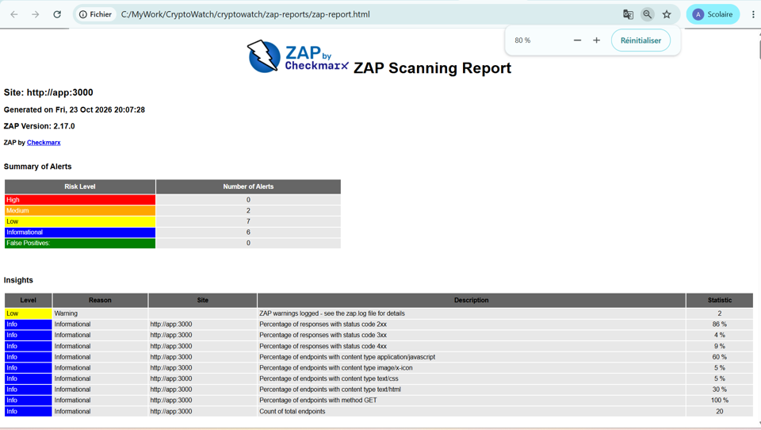
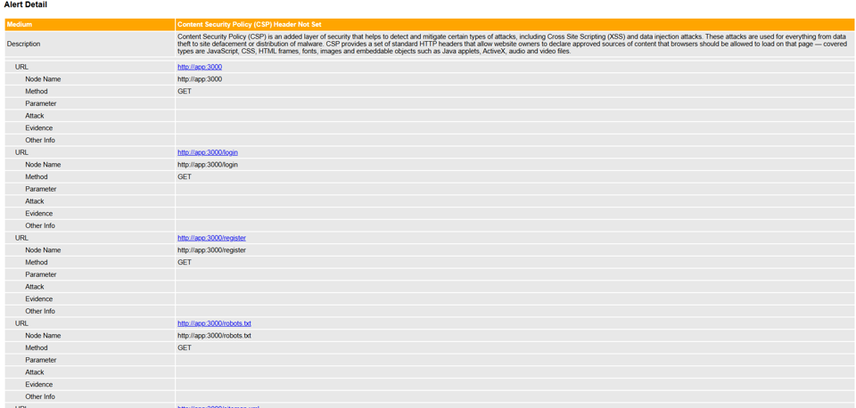
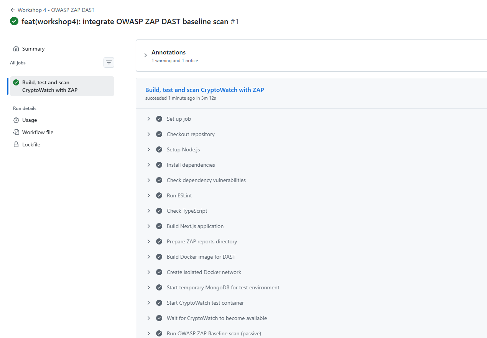

## Workshop 4 — OWASP ZAP : Détection automatique des vulnérabilités Web

### Membres du groupe — GR5

- Azzeddine Salmoun
- Wail Chairi Mahjor
- Toufik Kharkhour

### 1. Objectif

Découvrir et utiliser OWASP ZAP pour identifier les failles de sécurité d'une application Web. Le travail comprend un scan passif Baseline, l'analyse des alertes et l'intégration d'un contrôle DAST dans GitHub Actions.

### 2. Environnement

- Application : CryptoWatch (Next.js)
- Conteneurs : Docker
- Scanner : OWASP ZAP Baseline
- CI/CD : GitHub Actions (`ubuntu-latest`)
- Branche de travail : `workshop4-GR5`
- Cible du scan CI : conteneur CryptoWatch temporaire, accessible sur le réseau Docker sous `http://cryptowatch-zap:3000`

Le workflow crée un réseau Docker isolé, démarre une instance MongoDB de test, construit l'image CryptoWatch et attend que l'application réponde avant de lancer ZAP. Les identifiants et valeurs d'environnement utilisés dans ce conteneur sont des valeurs factices réservées aux tests CI ; aucun secret de production n'est utilisé.

### 3. Scan local initial — Baseline

Le scan Baseline local déjà réalisé sur CryptoWatch a produit le bilan suivant :

| Niveau | Nombre d'alertes |
|---|---:|
| High | 0 |
| Medium | 2 |
| Low | 7 |
| Informational | 6 |
| False positives déclarés | 0 |

Les deux alertes Medium relevées étaient :

1. **CSP Header Not Set** : absence de l'en-tête Content-Security-Policy. Une politique CSP aide à limiter les sources de contenu autorisées et à réduire l'impact de certaines attaques XSS.
2. **Missing Anti-clickjacking Header** : absence d'un en-tête de protection contre le clickjacking, notamment `X-Frame-Options` ou une directive CSP `frame-ancestors`.

Le rapport local ne signalait pas d'alerte concernant les cookies sans `HttpOnly` ou `Secure`. Cela signifie qu'aucune alerte correspondante n'a été signalée par ce scan ; ce n'est pas une preuve générale que tous les cookies sont sécurisés dans tous les contextes.

### 4. Interprétation et pistes de remédiation

- Définir une politique `Content-Security-Policy` adaptée aux ressources réellement utilisées par CryptoWatch. Commencer en mode `Content-Security-Policy-Report-Only` permet de tester la politique avant son application stricte.
- Ajouter une protection anti-framing avec `Content-Security-Policy: frame-ancestors 'self'` ou `'none'` selon le besoin fonctionnel. `X-Frame-Options: SAMEORIGIN` ou `DENY` peut être ajouté pour la compatibilité avec les navigateurs concernés.
- Vérifier que les cookies de session et d'authentification utilisent `HttpOnly`, `Secure` en HTTPS et un `SameSite` approprié.
- Relancer ZAP après les modifications et comparer les rapports pour confirmer les résultats.

Ces recommandations ne doivent pas être présentées comme des corrections déjà appliquées tant qu'elles n'ont pas été implémentées et vérifiées par un nouveau scan.

### 5. Intégration CI/CD avec GitHub Actions

Le workflow `.github/workflows/workshop4-zap-dast.yml` :

1. Installe les dépendances et vérifie npm audit, ESLint, TypeScript et le build Next.js.
2. Construit une image Docker de test.
3. Démarre une instance MongoDB de test et le conteneur CryptoWatch sur un réseau Docker isolé.
4. Attend que l'application réponde.
5. Exécute `zap-baseline.py` contre le conteneur de test. Le Baseline effectue un spider et une analyse passive ; il ne lance pas d'attaques actives.
6. Publie les rapports HTML, JSON et Markdown comme artefact GitHub Actions.
7. Arrête et supprime les conteneurs temporaires.

Le scan actif est optionnel et peut être déclenché manuellement depuis l'onglet Actions avec l'option `run_active_scan`. Il vise uniquement le conteneur éphémère construit par le workflow, jamais une instance de production. Le scan actif envoie des requêtes de test pouvant modifier des données ; il doit donc rester limité à un environnement isolé et autorisé.

Le Baseline utilise l'option `-I` : les alertes de niveau WARN sont conservées dans les rapports mais ne font pas échouer le job à elles seules. Les erreurs d'exécution du scanner ou de démarrage de l'application font échouer le workflow. Les alertes doivent être examinées et suivies, et non ignorées simplement pour obtenir un résultat vert.

### 6. Captures d'écran

Ajouter les captures réelles dans `docs/screenshots/` avec les noms suivants :

| Fichier | Contenu attendu |
|---|---|
| `01-zap-local-baseline-summary.png` | Résumé du scan local : 0 High, 2 Medium, 7 Low, 6 Informational |
| `02-zap-alerts-details.png` | Détails des alertes CSP et anti-clickjacking |
| `03-github-actions-zap-success.png` | Exécution réussie du workflow GitHub Actions |

### 7. Conclusion

OWASP ZAP permet d'automatiser une première vérification DAST passive de CryptoWatch et de rendre les alertes consultables à chaque exécution du workflow. L'intégration à GitHub Actions facilite la détection précoce des problèmes de configuration Web. Les alertes identifiées doivent être analysées, corrigées si nécessaire, puis vérifiées par un nouveau scan. Le scan actif est réservé à un environnement de test isolé et autorisé.
